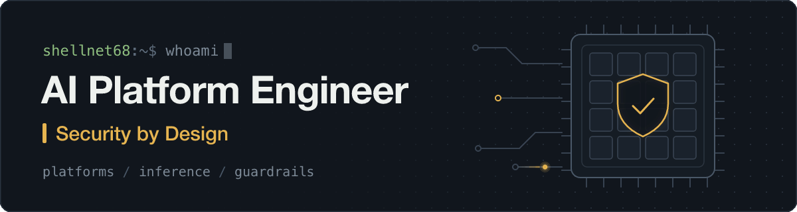

  <picture>
    <source media="(prefers-reduced-motion: reduce)" srcset="assets/banner.svg" />
    
  </picture>

# Hi, I'm shellnet68

I build the platform layer that runs AI workloads: inference serving, GPU scheduling, Kubernetes, and the identity, policy and observability around them. Security is part of that layer from the start: a platform default, not a separate review step.

## Focus areas

- **AI and GPU inference platforms:** model serving, GPU memory and scheduling trade-offs, and keeping model switching fast and predictable.
- **Kubernetes, GitOps and developer platforms:** declarative delivery, reproducible environments, and self-service paths for application teams.
- **Secure defaults:** least-privilege identity, workload isolation, secrets handling, and supply-chain hygiene in the default path.
- **Observability:** metrics and signals that explain what a platform is doing and why.

## Featured project

### [model-swapper](https://github.com/shellnet68/model-swapper)

Independent open source project, MIT licensed. It switches PyTorch models through pinned host memory, aiming to reduce the cost of moving between models on a GPU, and exposes Prometheus metrics so swap behaviour can be observed.

## How I work

- Defaults should be secure, and the secure path should also be the easy one.
- Platforms should be declarative, reviewable and reproducible.
- Measure behaviour before tuning it.

---

Independent personal profile. Views and projects here are my own.
